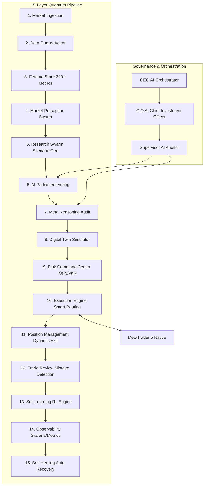

# XEDY V42 QUANTUM - Multi-Agent Orchestrator Architecture Specification

## Part 1: System Overview

### Mission
Build a complete institutional-grade autonomous trading platform specialized for XAUUSD, utilizing a 15-layer hierarchical multi-agent orchestrator framework. The system is designed to acquire market data, validate quality, engineer features, run AI swarms, vote on parliament consensus, simulate digital twins, execute smart-routing trades via MT5, and continuously self-learn and self-heal 24/7.

### Core Architecture Principles
- **Autonomous Swarms:** Decentralized specialist agents executing targeted research, technical, and macro tasks.
- **Hierarchical Governance:** Orchestration managed by CEO AI, CIO AI, and Supervisor AI.
- **Digital Twin Simulation:** Continuous safety testing via Monte Carlo and Stress Tests before real order execution.
- **Explainable Decision Ledger:** Auditable records of reasoning and risk parameters for every trade.

---

## Part 2: High Level Architecture

---

## Part 3: Detailed Layer Specifications

### 1. Market Data Acquisition Layer
Standardized real-time ingestion from multiple heterogeneous channels:
- **Brokers/Exchanges:** MT5, TradingView
- **Institutional Terminals:** Bloomberg, Reuters
- **Macro Economic Providers:** CNBC, FRED, TradingEconomics
- **Commitment of Traders (COT):** CFTC, ETF Flows, Central Bank Gold Reserves
- **Alternative Signals:** Social Media sentiment, Geopolitical News feeds, Weather, Global Shipping volumes
- **Indices:** DXY (Dollar Strength), US10Y (Bond Yields), VIX (Volatility Index), WTI/Brent Oil, Silver (XAGUSD Correlation)

### 2. Data Quality Layer
Controlled by the **Market Validation Agent** to ensure clean, standardized data stream:
- **Missing Candle Detection & Gap Filling:** Reconstructs missing history rates.
- **Duplicate Detection & Timezone Correction:** Aligning NY, London, and local server timestamps.
- **Spread & Outlier Validation:** Blocks toxic volatility and anomalous broker spikes.
- **Noise Filtering & Time Synchronization:** Prepares data for the internal Feature Store and Knowledge Graph database.

### 3. Feature Engineering Layer
Continuous calculation of over 300 standardized features:
- **Technical Baselines:** EMA, ATR, ADX, VWAP, RSI, MACD.
- **Microstructure:** Delta Volume, Volume Profile, Order Flow imbalance, Smart Money Order Blocks, Fair Value Gaps (FVG).
- **Macro Context:** Real Yields (US10Y - Inflation), Dollar Strength Score, ETF Flow Momentum, Macro Sentiment Score, News Risk Rating.

### 4. Market Perception AI Swarm
Dynamic collection of 18 specialist AI agents:
- *Trend AI*, *Momentum AI*, *Macro AI*, *Fundamental AI*, *Sentiment AI*, *Liquidity AI*, *Order Flow AI*, *Pattern AI*, *Wyckoff AI*, *Smart Money AI*, *Volume AI*, *Correlation AI*, *Volatility AI*, *Cycle AI*, *Session AI*, *Seasonality AI*, *Microstructure AI*, *Forecast AI*.

### 5. Research AI Swarm
Scientific validation of trading ideas:
- **Hypothesis Generator & Evidence Finder:** Scans for market anomalies.
- **Counter Evidence Search & Fact Checker:** Acts as devil's advocate to prevent confirmation bias.
- **Confidence Estimator & Scenario Probability Generator:** Calculates mathematical confidence for current market states.

### 6. AI Parliament
Consensus engine to decide the primary market action:
- Inputs from Trend, Macro, Forecast, Research, and Risk AIs.
- **Voting Process:** Runs weighted voting based on historical agent accuracy.
- **Output States:** `BUY`, `SELL`, or `WAIT`.

### 7. Meta Reasoning AI
Final checklist verification before trade dispatch:
- Checks data completeness, confidence threshold, overfit metrics, upcoming high-impact news releases, Black Swan triggers, and extreme volatility levels.
- **Decision:** `Trade? YES/NO`.

### 8. Digital Twin Market
Simulates execution in a sandbox environment:
- **Walk-Forward Validation:** Simulates strategies on recent unseen data.
- **Monte Carlo:** Runs 1,000 to 10,000 iterations to calculate Expected Return and Expected Drawdown.
- **Stress Testing:** Simulates historic events (e.g., FOMC spikes, SVB crash) to verify safety.

### 9. Risk Command Center
Portfolio-wide risk management:
- Computes Value at Risk (VaR), Conditional VaR (CVaR), Kelly Criterion sizing, Maximum Drawdown caps, and correlation exposure across multiple assets.
- Allocates capital and determines the precise lot size.

### 10. Execution Engine
Optimized routing system:
- Performs latency checks, spread checks, and selects the optimal broker path.
- Utilizes TWAP, VWAP, and Iceberg orders to minimize market impact.

### 11. Position Management AI
Post-entry execution optimization:
- Applies Dynamic SL/TP, Trailing Stop-Loss, Scale-In/Scale-Out rules, Partial Closures, and Time-based/Emergency Exits.

### 12. Trade Review AI
Post-trade post-mortem analysis:
- Analyzes trade execution metrics, identifies structural mistakes, logs root causes, and updates the knowledge database.

### 13. Self Learning Engine
Continuous optimization loop:
- Stores experiences in memory and trains models using Reinforcement Learning (RL).
- Optimizes weights and runs Champion vs Challenger tests before deploying models.

### 14. Observability Layer
System telemetry and health metrics:
- Real-time Grafana/Prometheus dashboard monitoring PnL, API Latency, CPU/GPU load, memory usage, winrate, Sharpe ratio, and drawdown.

### 15. Self Healing Layer
Fault tolerance and recovery:
- Monitors agent health, restarts crashed processes, recovers system states, and repeats the safety cycle 24/7.

---

## Part 4: Agent Orchestration Matrix

- **CEO AI Orchestrator:** Governs the entire life-cycle and synchronization.
- **CIO AI Strategist:** Allocates tasks and manages portfolio parameters.
- **Supervisor AI Auditor:** Audits decisions, risk limits, and ensures compliance.
- **Directors (Research, Risk, Execution, Learning, Observability):** Coordinate specialist swarms.

---

## Part 5: Operation & Backtest Workflows

### Operating Cycle
1. **Market Update:** Fetches data every 5 seconds.
2. **Multi-Agent Analysis:** Swarms update perceptions.
3. **Decision & Risk Validation:** Parliament consensus and Meta Reasoning checklist.
4. **Execution:** Positions executed and managed dynamically.
5. **Review & Self-Learning:** Telemetry logged, models updated.

### M5 Backtest Workflow (Rolling 1 Month)
- Ingests M1 historical rates $\rightarrow$ Resamples to M5 $\rightarrow$ Feeds 50 Strategy Agents $\rightarrow$ Parallel Backtest $\rightarrow$ Walk Forward Validation $\rightarrow$ 10,000 Monte Carlo simulations $\rightarrow$ Risk Qualification $\rightarrow$ Champion vs Challenger testing $\rightarrow$ Production.

---

## Part 6: XEDY V36 QUANTUM Roadmap

1. **Hierarchical Reinforcement Learning (HRL):** Split decisions between portfolio allocation (macro level) and trade execution (micro level).
2. **Dynamic Agent Marketplace:** Live hot-plugging of new specialist agents without server downtime.
3. **Causal Inference Engine:** Prove cause-and-effect relationships before incorporating new alpha features.
4. **Explainable Decision Ledger:** Incorruptible transaction trail containing reasoning, voting records, and risk scores behind every single trade.
