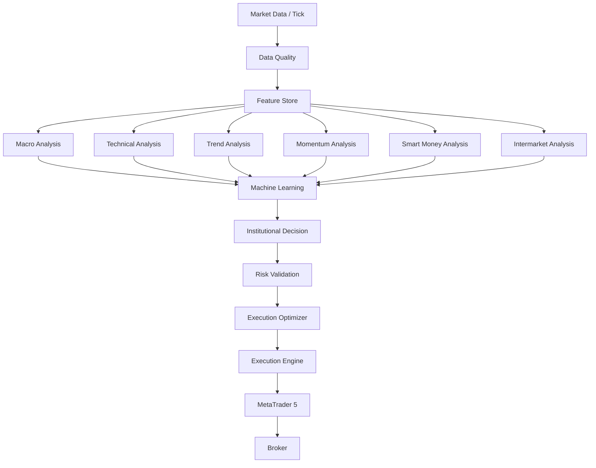
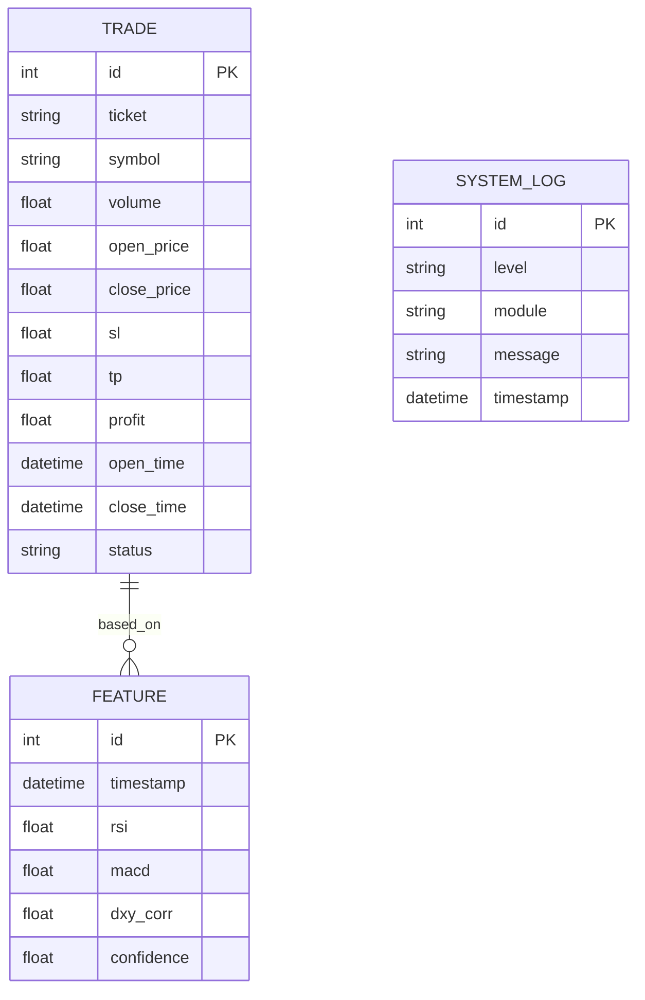
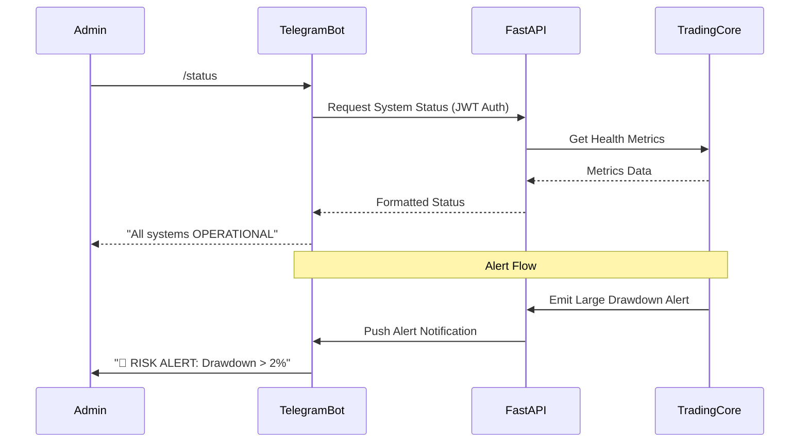

# XEDY V41 ULTIMATE - Architecture Specification Document

## Part 1: System Overview

### Mission
Build a complete institutional-grade autonomous trading platform specialized for XAUUSD, capable of analyzing, predicting, managing risk, and executing trades automatically through MT5, while monitoring infrastructure and continuously improving itself.

### Objectives
- Fully Modular Architecture
- High Performance, High Availability, Fault Tolerant
- Explainable AI with Local AI First
- Easy Maintenance & Upgradability
- Cloud Independent Trading

### System Scope
The system encompasses real-time data ingestion, multi-layered market analysis (macro, technical, trend, momentum, intermarket, smart money), machine learning inference, risk-validated institutional decision making, and automated MT5 execution, monitored via a comprehensive Web Dashboard and Telegram ecosystem.

### Core Components
- **Data Layer:** Ingestion & storage of market, macro, and alternative data.
- **Engine Layer:** Modular analysis engines providing localized insights.
- **Decision Layer:** Institutional logic for trade generation.
- **Execution Layer:** Order routing to MT5 and broker.
- **Presentation Layer:** FastAPI REST/WebSocket serving a Bootstrap 5 Web Dashboard and Telegram bots.

---

## Part 2: High Level Architecture

```mermaid
flowchart TD
    subgraph Presentation
        Dashboard[Web Dashboard]
        Telegram[Telegram Bots]
    end

    subgraph API Gateway
        FastAPI[FastAPI Server]
        REST[REST API]
        WS[WebSocket]
        FastAPI --> REST
        FastAPI --> WS
    end

    subgraph Core Trading Platform
        Scheduler[Task Scheduler]
        ML[Machine Learning Engine]
        Decision[Decision Engine]
        Execution[Execution Engine]
        Monitor[Monitoring Engine]
    end

    subgraph Database Layer
        SQLite[(SQLite DB)]
    end

    subgraph External Systems
        MT5[MetaTrader 5]
        Broker[Broker API]
    end

    Dashboard <--> FastAPI
    Telegram <--> FastAPI
    FastAPI <--> Core Trading Platform
    Core Trading Platform <--> SQLite
    Execution <--> MT5
    MT5 <--> Broker
```

---

## Part 3: Layered Architecture

1. **Infrastructure Layer**: OS (Windows 11 Pro), containerization (Docker), dependency injection.
2. **Communication Layer**: REST, WebSocket, internal event bus.
3. **Data Layer**: SQLite, Feature Store, Data Quality.
4. **Analysis Layer**: Macro, Technical, Trend, Momentum, Intermarket, Smart Money.
5. **AI Layer**: ML Engine, Probability, Forecast.
6. **Decision Layer**: Institutional Decision Engine.
7. **Risk Layer**: Risk Engine.
8. **Execution Layer**: Execution Optimizer, Execution Engine.
9. **Presentation Layer**: Web Dashboard, Telegram.
10. **Monitoring Layer**: System Health, Auto Recovery.
11. **Automation Layer**: Task Scheduler, Backtest, Replay.

---

## Part 4: Module Architecture (Selected Examples)

### Institutional Decision Engine
- **Purpose**: Central brain determining final trade entries/exits.
- **Responsibilities**: Aggregating inputs from all analysis engines, applying institutional logic, and passing to Risk Engine.
- **Inputs**: ML probability, Trend strength, Momentum, Smart Money bias.
- **Outputs**: Trade Proposal Event.
- **Dependencies**: Analysis engines, ML Engine.
- **Public Interface**: `evaluate_market_state(state: State) -> Decision`
- **Configuration**: Confidence threshold, time restrictions.

### Execution Engine
- **Purpose**: Direct interfacing with MT5.
- **Responsibilities**: Placing, modifying, and closing orders. Handling slippage and requotes.
- **Inputs**: Risk-approved Trade Proposal.
- **Outputs**: Trade Execution Status Event.
- **Dependencies**: MT5 Python API, Risk Engine.
- **Public Interface**: `execute_order(order: Order) -> Result`
- **Configuration**: Slippage tolerance, latency limits.

*(All other modules follow this strict Service Layer / Dependency Injection pattern.)*

---

## Part 5: Engine Architecture

- **Market Engine**: Real-time MT5 tick/bar ingestion.
- **Data Quality Engine**: Filtering bad ticks, filling gaps.
- **Feature Store**: Compiling standardized features for AI.
- **Macro Engine**: DXY, US10Y, Economic calendar parsing.
- **Technical/Trend/Momentum Engines**: Multi-timeframe indicator calculations.
- **Intermarket Engine**: Correlating XAUUSD with Silver, Oil, VIX.
- **Smart Money Engine**: COT reports, ETF Flow analysis.
- **Machine Learning Engine**: XGBoost/LightGBM model inference via ONNX.
- **Probability/Forecast Engines**: Producing confidence scores and target prices.
- **Institutional Decision Engine**: Core logic application.
- **Risk Engine**: Validating max drawdown, margin, and exposure.
- **Execution Optimizer**: Determining best entry micro-structure.
- **Execution Engine**: Order placement via MT5.
- **Replay/Backtest Engines**: Historical validation.
- **Analytics Engine**: Trade performance metrics.
- **Self Learning Engine**: Post-trade evaluation and automated retraining triggers.

---

## Part 6: Data Flow



---

## Part 7: Database Architecture


*Note: SQLite will utilize Write-Ahead Logging (WAL) for high concurrency.*

---

## Part 8: API Architecture

- **REST API**: Structured via FastAPI Routers (e.g., `/api/v1/trades`, `/api/v1/system`).
- **WebSocket**: `/api/v1/ws` for real-time dashboard updates (ticks, active trades).
- **Authentication**: JWT tokens passed in `Authorization: Bearer` headers.
- **Rate Limiting**: Configured per endpoint to prevent UI spam.
- **Error Handling**: Standardized JSON responses with detailed error codes.

---

## Part 9: Web Dashboard Architecture

- **Technology**: Bootstrap 5, HTML5, CSS3, Vanilla JS, Plotly.
- **Layout**: Sidebar navigation, Topbar status, Main content area.
- **Hierarchy**:
  - Executive Overview (High-level PnL, Status)
  - Analytical Views (Market, Macro, Technical, Intermarket, Smart Money, ML)
  - Operational Views (Open Positions, Trade History, Portfolio, Risk)
  - System Views (Replay, Backtest, Analytics, Telegram, Health, Settings)
- **Real-time Strategy**: WebSocket listeners in JS updating DOM elements incrementally (< 500ms).

---

## Part 10: Telegram Architecture


- **Bots**: Separated logically (News, Trade, Market, Health, Report, Admin, Emergency).
- **Security**: Administrator ID validation mapping.

---

## Part 11: Security Architecture
- **JWT / RBAC**: Dashboard users mapped to roles (Admin, Viewer).
- **Encryption**: API keys and database credentials encrypted at rest.
- **Audit Trail**: Every trade, config change, and system start logged immutably.

---

## Part 12: Monitoring Architecture
- **Metrics Tracked**: CPU/RAM usage, API latency, MT5 connection state, database size.
- **Auto Recovery**:
  - Automatically restarts disconnected MT5 sessions.
  - Pauses trading on high system latency or VIX spikes.

---

## Part 13: Deployment Architecture
- **Environment**: Docker & Docker Compose for isolated execution (except MT5 which is native Windows 11).
- **Configuration**: `.env` driven.
- **Backup Strategy**: Daily automated SQLite backups.

---

## Part 14: Testing Architecture
- **Unit Tests**: Pytest mocking MT5 and DB.
- **Integration Tests**: Full flow from Feature Store to dummy execution.
- **Validation**: Walk-forward optimization and Monte Carlo simulation built into the Backtest Engine.

---

## Part 15: Project Roadmap

- **Phase 1: Foundation** (Infrastructure, DB, Config, API, Logging)
- **Phase 2: Trading Core** (Market Data, MT5 integration, Risk, Decision)
- **Phase 3: Dashboard** (Frontend components, WebSocket streaming)
- **Phase 4: Automation** (Machine Learning, Telegram, Schedulers)
- **Phase 5: Production Deployment** (Security, Testing, Final Optimization)
